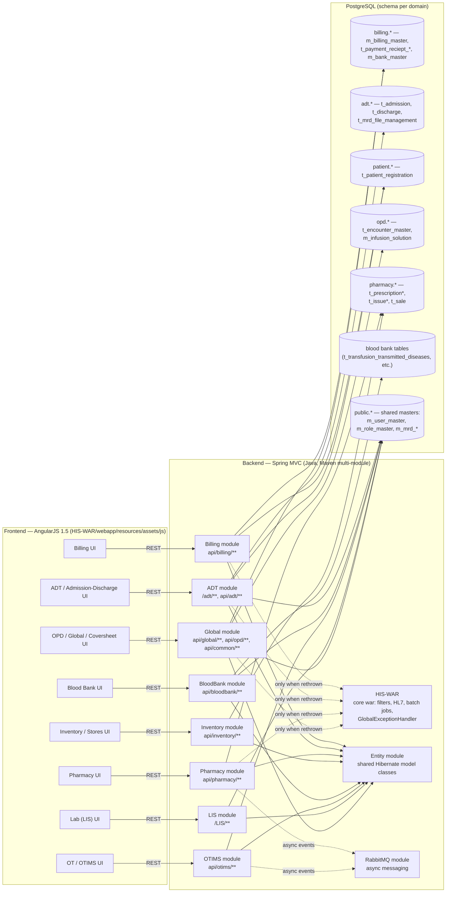

# Dependency Graph — Frontend / Backend / Database

Generated by read-only exploration of `/legacy` (his-clinivantage-hf-3.08.1.2, the clean pre-upgrade baseline). High-level only: major modules, not every file. No files in `/legacy` were modified to produce this diagram.

Frontend is AngularJS 1.5 (`HIS-WAR/src/main/webapp/resources/assets/js`), backend is a Spring MVC multi-module Maven project (Java), database is PostgreSQL with one schema per clinical/business domain.

## Notes

- The dotted lines into `GlobalExceptionHandler` are labeled "only when rethrown" deliberately: see `docs/DATA_TRUTH_REPORT.md`, section "Exception Handling Baseline" — most sampled modules catch exceptions locally and never let them reach the centralized handler, contrary to the constitution's mandate.
- DAO layer uses Hibernate (`SessionFactory`, named queries, HQL, and raw `createSQLQuery` native SQL) — not Spring Data JPA repositories.
- `Entity` module holds shared Hibernate model classes referenced by every domain module; it has no controllers/services of its own.
- `Global` module is a cross-cutting module (not just "global masters") — it contains controllers/services/DAOs for opd, billing-adjacent, doctor, org, pharmacy, procedure, mrd, and more, in addition to genuinely global concerns like privilege/role/security.
